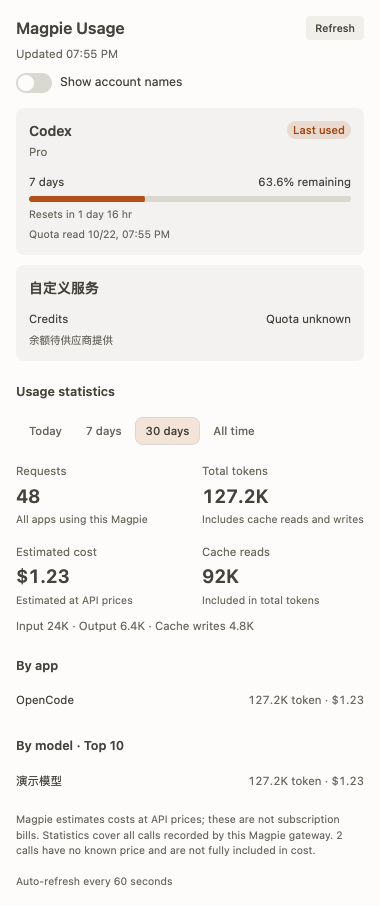

# Magpie Usage for OpenChamber

[简体中文](README.zh-CN.md) · [Releases](https://github.com/ChengMaoDev/openchamber-magpie-usage/releases)

A community extension that brings local [Magpie](https://usemagpie.ai) subscription quotas, token usage and estimated costs into [OpenChamber](https://openchamber.dev). Built with the official `@openchamber/sdk`; independent of both projects.

<picture>
  <source media="(prefers-color-scheme: dark)" srcset="docs/panel-dark.png">
  
</picture>

## Install

Requires **OpenChamber 2.5.0+** on web or desktop, and Magpie running **on the OpenChamber server's machine**. Tested with Magpie **0.1.1318** on macOS. Linux and Windows are not runtime-tested.

1. Open **Settings → Extensions → Add extension**.
2. Paste `https://github.com/ChengMaoDev/openchamber-magpie-usage` or select the ZIP from [Releases](https://github.com/ChengMaoDev/openchamber-magpie-usage/releases).
3. Review and approve **Run a local service**.
4. Open **Magpie Usage** from the right rail, or enable **Magpie** in the Work Status section list. The extension does not add a page in the main workspace.

Git URL installs can receive updates through OpenChamber. Folder installs use the folder directly; rebuild and reload after changes. ZIP installs must be updated manually. The package includes built JavaScript; installation requires no Bun, system Node or dependency download.

The official SDK currently has no registration hook for the built-in **Settings → Usage** provider registry. This extension provides a sidebar panel and Work Status section. VS Code and mobile do not load SDK extensions yet.

This is an **OpenChamber extension**. Install it through **Settings → Extensions**, using the Git URL or ZIP above. Do not add its name to **OpenCode → Plugins** or the `plugins` configuration: that loader cannot load this extension and reports `Plugin entrypoint not found`. npm distribution has been discontinued.

## Features

- Separate account quotas, balances and reset clocks. Marks the account used most recently; unknown limits stay unknown.
- Today, rolling 7-day, rolling 30-day and all-time requests, input/output tokens, cache tokens and estimated costs.
- Usage by app and top 10 models. Statistics include all calls recorded by the connected Magpie gateway, not just the active session.
- English, 简体中文, 繁體中文 and 日本語 automatically follow OpenChamber, including live language changes. Other languages fall back to English. Provider-supplied labels and errors stay as Magpie returned them; the rail entry uses the stable name **Magpie Usage**.
- Account names hidden by default, with an explicit switch to reveal them. This is a display preference, not an access-control boundary; provider-supplied names/errors can still identify an account.
- Bottom tags choose **Relaxed**, **Medium** or **Compact** quota displays: cards, account rows or small rings. A button beside Refresh switches all quota values and progress between remaining and used, remembering the choice without fetching data. Warning colors track exhaustion in either view. Account names stay inline when enabled. Statistics retain their full layout in the sidebar; Work Status shows quotas with a scrollable account region and visible bottom controls.
- Each account uses one compact ring. Multiple quota windows are summarized with the lowest remaining or highest used value, and unknown windows are counted separately. This applies to every provider, including Antigravity and Google AI Studio. Hover or keyboard focus shows the original entries and reset times in a tooltip; clicking rings never expands or rearranges the grid. The Medium and Relaxed layouts show every quota window.
- Cached quota polling every 60 seconds while visible. Opening or clicking Refresh requests current quotas; the last upstream read time is shown. After an error polling pauses until a successful manual refresh.
- Fast period changes coalesce into one queued request. Stale responses never populate a different period; failures keep valid results with a warning.

Token totals add input, output, cache reads and cache writes. Reasoning tokens are not added again. Costs are Magpie's estimates at API prices, **not subscription charges**; calls missing prices are disclosed.

## Connection and permissions

The sandboxed panel calls `host.serviceRequest()`. OpenChamber starts the bundled service, allocates its loopback port and credential, and proxies requests. The service verifies that credential on every request, including `/health`, and listens only on `127.0.0.1`.

The service reads only the `port` setting from `~/.config/magpie/settings.json` (`XDG_CONFIG_HOME` when passed by the host), defaulting to `3425` when the file is absent. It makes fixed GET requests to Magpie's `/v1/magpie/quotas` and `/v1/magpie/usage` endpoints on loopback, without redirects. No remote Magpie configuration is supported. With remote OpenChamber, this means the server's Magpie, not your browser computer's.

No model calls, telemetry, provider credentials, OpenCode configuration changes or conversation reads. Responses are bounded and validated; extra upstream fields are removed before reaching the panel. The local service runs with your user permissions, as all OpenChamber SDK services do; approve only extensions you trust. No shell execution or arbitrary URL proxy is exposed.

## Development

```sh
bun install --frozen-lockfile
bun run verify
bun run package
```

`panel/` and `service/` are committed build outputs required for Git URL installs. The ZIP and its SHA-256 checksum are written under `release/`. Packaging replaces the archive rather than retaining files from an earlier release.

Optional checks against your local Magpie:

```sh
bun scripts/verify-live.ts
bun scripts/verify-bundle.ts
```

Browser regression uses Python Playwright via `uv` and its Chromium browser (`uv run --with playwright playwright install chromium`). Serve this folder on loopback port `58742`, then run `uv run --with playwright python scripts/ui-smoke.py`. It uses synthetic data and the real SDK iframe message protocol; no user data is captured in its screenshots.

## License and icon

Code: [MIT](LICENSE). The Magpie SVG comes from the upstream MIT-licensed repository, with its geometry unchanged and `currentColor` added for host theme colors. Attribution, pinned source and the upstream license are in [THIRD-PARTY-NOTICES.md](THIRD-PARTY-NOTICES.md). Reuse does not imply official affiliation or endorsement; no trademark rights are claimed.

## References

- [OpenChamber extension SDK](https://docs.openchamber.dev/sdk/)
- [Host API](https://docs.openchamber.dev/sdk/host/)
- [Local service contract](https://github.com/openchamber/openchamber/blob/main/packages/sdk/GUEST_SERVICES.md)
- [Magpie integration APIs](https://usemagpie.ai/docs/integrate)
